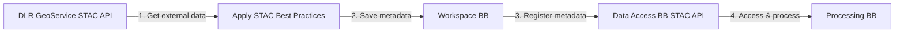

# Register external data: Cloud Fraction

This notebook converts the [end-to-end use case](https://github.com/EOEPCA/demo/blob/main/demoroot/notebooks/08-1%20E2E%20External%20Data%20Registration%20CF.ipynb) into an interactive Killercoda scenario. It registers Sentinel-5P Cloud Fraction data from the DLR GeoService into the EOEPCA STAC API, following STAC Best Practices.

## Scenario overview

The EOEPCA platform lets employees access and process earth observation data. In this case we combine NO2 and cloud cover to build cloud-free monthly composites. This scenario covers the first step of a three-part workflow:

1. **E2E External Data Registration Cloud Fraction** (this scenario)
2. [E2E External Data Registration NO2](https://github.com/EOEPCA/demo/blob/main/demoroot/notebooks/08-2%20E2E%20External%20Data%20Registration%20NO2.ipynb)
3. [E2E Process Data Jointly](https://github.com/EOEPCA/demo/blob/main/demoroot/notebooks/08-3%20E2E%20Process%20Data%20Jointly.ipynb)

### What happens in this scenario

1. Get external data: Cloud Fraction
2. Apply STAC Best Practices
3. Save metadata to the EOEPCA Workspace
4. Register metadata to the EOEPCA STAC API
5. Access and process the data

### End-to-end workflow

The pipeline runs across the Data Cube Access, Data Access, Workspace and Processing Building Blocks:



## Prerequisites

Before starting this scenario make sure you have done the following:

- Cloned this scenario repository to your local machine and checked out the appropriate branch.
- Created a Python virtual environment (see `requirements.txt`) and installed the required packages.
- Configured the connection parameters in a `.env` file (see the setup below).

## Setup your environment

Create and activate a virtual environment for this scenario:

```
python -m venv ~/eoepca-venv
source ~/eoepca-venv/bin/activate
```

Install the dependencies:

```
pip install -r requirements.txt
```

### Configure connection parameters

Set up the environment variables needed for authentication, the STAC API and the Workspace API. A `.env` file is used to load them:

```
cat > .env <<'ENV'
# --- connection setup ---
STAC_ENDPOINT="http://eoapi.eoepca.local/stac"
WORKSPACE_API_ENDPOINT="http://workspace-api.eoepca.local/workspaces"
AUTH_ENDPOINT="http://auth.eoepca.local/realms/eoepca"

# --- auth config: use the public clients of the Data Access and Workspace Building Blocks ---
STAC_AUTH_PUBLIC_CLIENT_ID="eoapi"
STAC_AUTH_PUBLIC_SCOPE="roles offline_access"

WORKSPACE_AUTH_PUBLIC_CLIENT_ID="workspace-api"
WORKSPACE_AUTH_PUBLIC_SCOPE="roles offline_access"

# The following are only used if you switch to a headless password flow.
# Leave them blank to use the device flow.
WORKSPACE_AUTH_CLIENT_ID=""
WORKSPACE_AUTH_CLIENT_SECRET=""
WORKSPACE_AUTH_SVC_USERNAME=""
WORKSPACE_AUTH_SVC_PASSWORD=""
ENV
```

```
source .env
```

---

## Step 1: Get external data: Cloud Fraction

Get the Sentinel-5P Cloud Fraction data from the DLR GeoService STAC API.

- **S5P Cloud Fraction InPuls L3:** EOC Geoservice Sentinel-5P TROPOMI L3 Daily Composites - Cloud Fraction (CF)
- https://geoservice.dlr.de/eoc/ogc/stac/v1/collections/S5P_TROPOMI_L3_P1D_CF_v2

Activate your environment:

```
source ~/eoepca-venv/bin/activate
```

### Import libraries

```
python - <<'PY'
from pystac import Item, Collection, Catalog, Extent, SpatialExtent, TemporalExtent, Asset, CatalogType
from pystac_client import Client
from odc.stac import stac_load
from datetime import datetime, timezone
import numpy as np
import pandas as pd
import certifi

import xarray as xr
import rioxarray
import rasterio
from shapely.geometry import Polygon, mapping

import jwt
import requests
import time
import os
from dotenv import load_dotenv
import json
import boto3

print("All libraries imported.")
PY
```

{{exec}}

### Handle DLR GeoService certificates

Ensure the DLR GeoService certificate is trusted by setting the cert bundles.

```
python - <<'PY'
import os, certifi
os.environ["REQUESTS_CA_BUNDLE"] = certifi.where()
os.environ["CURL_CA_BUNDLE"] = certifi.where()
print("Certificate bundles configured.")
PY
```

{{exec}}

### Open the DLR STAC client

Open the DLR GeoService STAC API catalog so we can query it.

```
python - <<'PY'
url = "https://geoservice.dlr.de/eoc/ogc/stac/v1/"
catalog = Client.open(url)
print(f"Opened DLR GeoService STAC API at {url}")
PY
```

{{exec}}

### Define the query parameters

Set the collection ID, the European bounding box, and the date range for the query.

```
python - <<'PY'
collection_id = "S5P_TROPOMI_L3_P1D_CF_v2"
bbox = [-10.0, 35.0, 30.0, 70.0]   # Europe
date_time = "2023-08-01T00:00:00Z/2023-12-31T23:59:59Z"
print(f"Querying collection {collection_id} for {date_time} over {bbox}")
PY
```

{{exec}}

### Query the external data

Request the Sentinel-5P Cloud Fraction data over Europe for the given date range.

```
python - <<'PY'
items = list(catalog.search(
    collections=[collection_id],
    bbox=bbox,
    datetime=date_time,
    limit=400,
).items())
print(f"Number of items: {len(items)}")
PY
```

{{exec}}

### Check the returned metadata items

Inspect the number of items and their information.

```
python - <<'PY'
print(f"Number of items: {len(items)}")
print(f"First item     : {items[0]}")
print(f"Last item      : {items[-1]}")
print(items[0])
PY
```

{{exec}}

### Check the data values

Load the data to confirm it is valid.

```
python - <<'PY'
ds = stac_load(
    items,
    bands=["cf"],
    resolution=0.1,            # native resolution
    bbox=bbox,
    chunks={"time": 1},
)
print(ds)
PY
```

{{exec}}

### Compute monthly cloud fractions

Compute and inspect a monthly median of the cloud fraction to sanity-check the loaded data.

```
python - <<'PY'
monthly_mean_cf = ds["cf"].groupby("time.month").median(dim="time")
print(monthly_mean_cf)
PY
```

{{exec}}

```
python - <<'PY'
monthly_mean_cf.plot(col="month", col_wrap=3, cmap="viridis",
                     vmin=0, vmax=1, figsize=(12, 6),
                     cbar_kwargs={"label": "Cloud Fraction"})
PY
```

{{exec}}

**Checkpoint:** the Sentinel-5P Cloud Fraction data is fetched from the DLR GeoService STAC API and confirmed loadable. In the next scenario [Apply STAC Best Practices](./04-prepare-stac.md) you will adapt this data to conform to STAC Best Practices before registration.